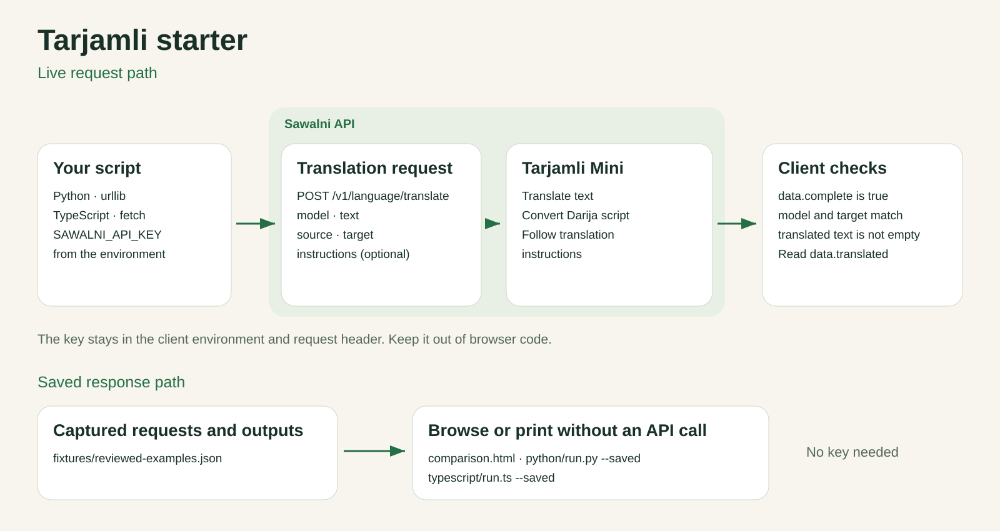

# Tarjamli starter

Translate your own text with Tarjamli through the [Sawalni API](https://api.sawalni.com). Python and TypeScript clients are included, with examples for translation, Darija Arabic ↔ Latin conversion, and instructions that change how a translation is written.

## Translate something

Create an API key at [api.sawalni.com](https://api.sawalni.com) and set it in your terminal:

```sh
export SAWALNI_API_KEY="your-key"
```

Python 3.10+:

```sh
pip install tarjamli
```

Then translate your own text:

```sh
python3 python/run.py --text 'واش تقدر تصيفط ليا الدوسي؟' --source ary_Arab --target fra_Latn
```

For TypeScript, use Node 20+:

```sh
npm ci
npm run example -- --text 'واش تقدر تصيفط ليا الدوسي؟' --source ary_Arab --target fra_Latn
```

Replace the text and language codes with your own. Both commands print the translation. List supported codes with `python3 python/run.py --languages` or `npm run example -- --languages`.

## Give the translation context

Add `--instructions` when the target language needs information that the source leaves open:

```sh
python3 python/run.py --text 'واش تقدر تصيفط ليا الدوسي؟' --source ary_Arab --target fra_Latn --instructions 'Address one person formally using vous.'
```

The saved result for this request is `Pourriez-vous m'envoyer le dossier ?`. Change the instruction to `Address one person informally using tu.` and compare. The same option works in TypeScript. Instructions can also supply speaker gender or a casual or formal tone.

## Convert Darija between scripts

Use the same language with different script codes:

```sh
python3 python/run.py --text 'سلام، كيف داير؟' --source ary_Arab --target ary_Latn
```

Reverse the source and target to convert Latin-script Darija to Arabic script.

## Call it from your code

Python:

```python
from tarjamli import Tarjamli

client = Tarjamli()
result = client.translate(text, source=source, target=target,
                          instructions="Address one person formally using vous.")
print(result.text)
```

TypeScript:

```ts
import { translate } from "./typescript/tarjamli.js";

const result = await translate(text, source, target, "Address one person formally using vous.");
console.log(result.data.translated);
```

## Request flow



The clients send `POST /v1/language/translate` with `text`, `source`, `target`, and optional `instructions`. They use `tarjamli-mini-v4`, which supports instructions. Nano does not. The Python SDK uses the standard library; TypeScript uses Node’s fetch. Keep the key on the server, outside browser code.

## Try the included examples

Run `python3 python/run.py` to list example IDs. Run an ID to make a live request, or add `--saved` to inspect its stored response without a key:

```sh
python3 python/run.py french-vous-darija
python3 python/run.py --saved tamazight-water
npm run example -- --saved tachelhit-water
```

[Browse the saved results](comparison.html). Examples cover Darija translation, script conversion, address forms, gender, tone, and short Tachelhit and Tamazight inputs. They are starting points: change the input and compare the output.

## Files

- Python uses the `tarjamli` package; `typescript/tarjamli.ts` is the TypeScript client.
- `python/run.py` and `typescript/run.ts`: command-line entry points.
- `languages.json`: supported language and script codes.
- `examples/cases.json`: example requests.
- `fixtures/reviewed-examples.json`: stored responses used by the offline preview.

## Errors and tests

The clients reject HTTP errors, incomplete responses and unexpected model or language identities. They do not retry requests automatically. Live requests use your API balance. The scripts read `SAWALNI_API_KEY` from the environment; they do not load `.env` files.

```sh
python3 -m unittest discover -s tests -p 'test_*.py'
npm test
npm run typecheck
```

[MIT license](LICENSE).
